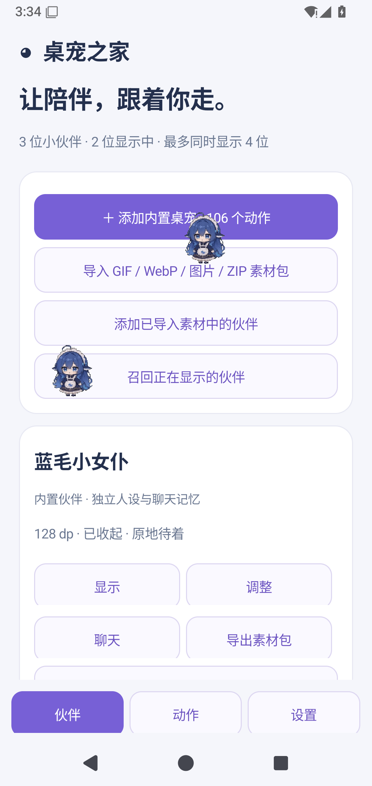
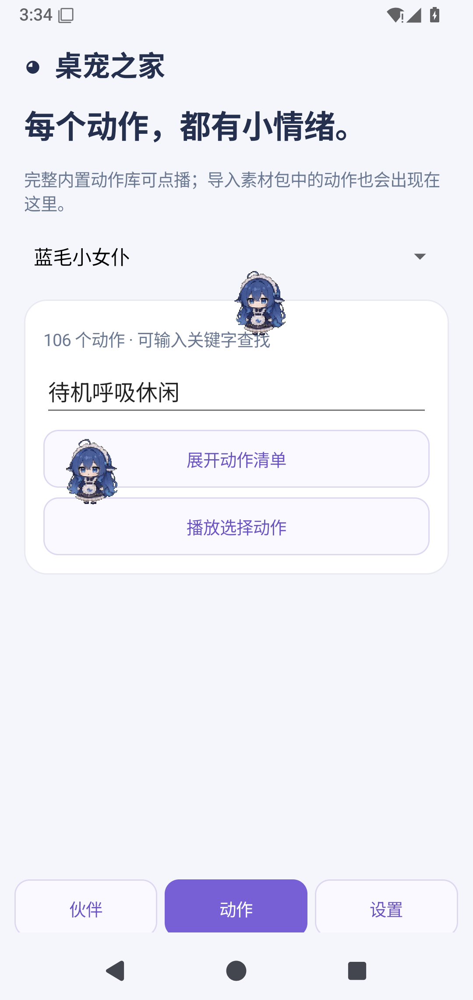

<div align="center">

# 桌宠之家 · DSH Pet Desktop

**给桌面和手机多一点陪伴**

透明动画 · 多宠物 · 可选 AI 对话

[下载安装](#安装) · [Android 说明](android/README.md) · [导入桌宠](docs/pet-packs.md) · [跨平台构建](docs/cross-platform.md)

</div>

---

支持 **Windows、macOS、Linux 和 Android** 的宠物陪伴应用。透明动画、可拖拽的小伙伴、可选的 AI 对话，以及独立的控制中心。

基于 [PC2005-cloud/dsh-pet](https://github.com/PC2005-cloud/dsh-pet) 开发，保留原项目的动画运行时与 MIT 许可。**安装桌面包或 Android APK 即可使用，不需要 DeepSeek Harness、Node.js 或浏览器。**

[下载安装](#安装) · [Android 说明](android/README.md) · [跨平台构建](docs/cross-platform.md) · [导入其他桌宠](docs/pet-packs.md) · [验证记录](docs/validation-2026-10-24.md) · [从源码运行](#从源码运行) · [原插件文档](docs/upstream-plugin.md)

[](https://github.com/w1nterdec/dsh-pet-desktop/actions/workflows/desktop-build.yml)
[](https://github.com/w1nterdec/dsh-pet-desktop/actions/workflows/android-build.yml)

当前开发预览：**桌面版 0.5.0-beta.1 · Android 0.2.0-beta.1**。新版已加入完整 Android 动作库、多宠物与 AI 聊天，并统一桌面和 Android 的精灵图动作包导入。


## 功能

- **桌面陪伴**：透明置顶小窗、待机和随机动作、点击回应、拖拽甩抛、右键动作菜单、多屏活动。
- **桌宠管理**：添加、复制、移除、改名，设置大小、起始角落、边距、显示状态和独立人设；支持撤销未保存的更改与 Ctrl+S。
- **找回小伙伴**：一键召回内置桌宠到右下角，恢复桌面显示。
- **AI 与对话**：支持 OpenAI 兼容接口与 Anthropic，可测试连接、手动聊天与碎碎念。AI 默认关闭，自动碎碎念需单独开启。
- **应用偏好**：浅色 / 深色 / 跟随系统、开机启动、启动时收起控制中心、关闭窗口后继续陪伴或退出应用。
- **数据管理**：原生文件选择器导入导出桌宠配置；导入需确认，并在替换前备份现有配置；备份不包含 AI 密钥。
- **运行维护**：记住窗口尺寸与位置，单实例运行，托盘唤回，打开数据目录与日志、复制诊断信息、重启和退出。
- **素材导入**：ZIP / WebM / GIF / 图片 / 视频 / PNG 序列 / 网格精灵图，以及 Shimeji 外观适配；每包最多 128 个动作，导入校验、失败回滚、显示隐藏和配置归档。非 WebM 格式在桌面端需要 FFmpeg。
- **跨平台开发**：macOS Intel / Apple Silicon 的 DMG/ZIP、Linux AppImage/Debian 构建入口，Linux XDG 自启动与 Wayland 能力提示；Android 内置 106 个动作、多宠物悬浮窗、物理交互、可选 AI 聊天与加密记忆。
- **发行交付**：Windows x64 安装向导、快捷方式、卸载入口，以及桌面多平台和 Android 的构建工作流。


## Android 0.2

- **完整动作库**：内置「蓝毛小女仆」106 个动作，安装后即可离线播放，支持动作搜索、点播、点击回应和长按菜单。
- **多只伙伴**：最多保存 12 只、同时显示 4 只，独立名字、人设、大小、位置和聊天记忆。
- **物理交互**：拖拽抛掷、重力反弹、可选碰撞、固定或自主移动、省电模式；屏幕关闭暂停动画、物理与自动问候。
- **原生 AI 聊天**：Chat Completions 兼容接口、OpenAI Responses、Anthropic Messages；流式回复、取消、连接测试和上下文设置。AI 与自动问候默认关闭，密钥及聊天记忆使用 Android Keystore 加密。
- **素材管理**：导入 GIF、动态 WebP、图片、PNG 序列、精灵图与 ZIP；保留旧包，可复用已有素材创建伙伴、导出可移植动作包。
- **原生界面**：伙伴 / 动作 / 设置页面，浅色、深色与跟随系统主题，通知栏可停止全部悬浮窗。

<p>
  
  
</p>

以上为 Android 15 模拟器中的实际界面。最低支持 **Android 9 / API 28**，完整资源 APK 约 **71 MiB**；详细说明见 [Android README](android/README.md)。

## 安装

### 新版跨平台预览包

- **Windows x64**：[已验证桌面构建](https://github.com/w1nterdec/dsh-pet-desktop/actions/runs/40108562238) → `DSH-Pet-Windows-x64`，解压后运行 EXE 安装向导。
- **macOS Intel / Apple Silicon**：同一桌面构建 → `DSH-Pet-macOS-x64` / `DSH-Pet-macOS-arm64`，选择对应架构的 DMG。
- **Linux x64**：同一桌面构建 → `DSH-Pet-Linux-x64`，提供 AppImage 和 Debian 安装包。
- **Android 9 及以上**：[已验证 Android 构建](https://github.com/w1nterdec/dsh-pet-desktop/actions/runs/40108238030) → `DSH-Pet-Android-preview`，解压后安装 `app-debug.apk`。

下载步骤：登录 GitHub → 打开对应运行记录 → 滚动到 **Artifacts** → 下载并解压所需平台的 ZIP。后续版本可从 [桌面工作流](https://github.com/w1nterdec/dsh-pet-desktop/actions/workflows/desktop-build.yml) 或 [Android 工作流](https://github.com/w1nterdec/dsh-pet-desktop/actions/workflows/android-build.yml) 中选择最新成功的运行。

### 已发布 Windows 版本

[Releases](https://github.com/w1nterdec/dsh-pet-desktop/releases/latest) 当前提供 **0.4.1**，文件为 `DSH-Pet-Setup-0.4.1-x64.exe`。本轮跨平台和 Android 0.2 更新的安装包位于上方 Actions 产物。

2026-10-24 已通过 Windows、macOS Intel / Apple Silicon、Linux X11 的原生交互检查，以及 Android 编译、单元测试、Lint 和 Android 9/15 模拟器测试。不同设备的多屏、桌面环境、手机厂商后台策略与长时间耗电仍需真机验收。详见 [跨平台说明](docs/cross-platform.md) 和 [本轮验证记录](docs/validation-2026-10-24.md)。

Windows 安装包默认安装到当前用户目录，无需管理员权限。桌面预览包尚未完成发行签名及 macOS 公证；Android 预览包使用开发调试签名。

## 使用

### 桌面版

1. 打开「DSH Pet」，控制中心与桌面小伙伴会一起出现。
2. 在「我的桌宠」调整名字、大小、位置或性格，然后点击「保存更改」。配置会立即应用。
3. 在「AI 与对话」填写服务商的基础接口地址、模型 ID 和 API 密钥，测试连接后显式启用 AI。
4. 右键桌宠选择动作、对话或碎碎念。自动碎碎念可能产生 API 费用，默认关闭。
5. 默认关闭控制中心只会收起窗口，桌宠继续运行。点击托盘图标可唤回；托盘菜单或面板中的「退出应用」会结束整个应用。

开机启动在打包后的 Windows / macOS / Linux 应用中可配置，Linux 遵循 XDG Autostart。开机登录时会收起面板；「启动时收起控制中心」也可控制普通启动行为。关闭开机启动会移除本应用对应的启动项。

### Android 版

1. 安装 APK 并打开应用，允许「显示在其他应用上层」；Android 13 起建议允许通知。
2. 在「伙伴」显示内置宠物，或添加、导入其他伙伴；拖动调整位置，长按打开菜单。
3. 在「动作」选择伙伴、搜索并播放动作；在「设置」调整主题、重力、碰撞和省电模式。
4. 需要 AI 时，填写 HTTPS 服务商地址、模型 ID 和自己的密钥，保存并启用。手动聊天、连接测试和已开启的自动问候会调用服务商接口，可能产生费用。
5. 点击通知栏「停止全部」可关闭所有悬浮窗。

Android 的密钥与聊天由 Keystore 加密，私密页面禁止截图；数据与桌面版分别保存，不自动同步。素材导出仅包含动画和清单。权限、备份和当前格式边界见 [Android 说明](android/README.md)。

### 桌面数据与隐私

- 桌宠配置和运行日志默认位于 `%USERPROFILE%\.dsh\dsh-pet`，可用 `DSH_HOME` 指定其他根目录。
- `main-config.jsonc`：内置桌宠配置；`desktop-settings.json`：应用偏好与窗口位置。
- `standalone-ai.json`：本机 AI 连接设置与密钥；`memory.json`：对话记忆；`logs.txt`：运行日志。
- 密钥不回显，保存在当前用户可访问的本机配置中。启用 AI 后，对话内容和必要上下文会发送给你填写的服务商；本应用没有自建中转服务。
- 导出的 JSON 仅包括内置桌宠配置及屏幕约束开关；不包括 API 密钥、聊天记忆、应用偏好或额外 pet pack 素材。
- 导入前会先检查格式，并要求确认。原有主配置备份为 `main-config.before-import.jsonc`；导入不会覆盖额外 pet pack 配置或 AI 设置。
- 诊断复制仅包含版本、系统、架构与运行模式，不包含密钥和本机路径。

### 边界

独立桌面应用不提供 DSH 的余额查询、会话工作状态或 DSH 系统通知。额外 pet pack 和自定义动画沿用原项目文件结构。控制中心可导入素材包并管理显示/隐藏/移除；召回和主配置编辑仍作用于内置桌宠。Android 0.2 提供原生 AI 聊天、独立人设和本机加密记忆，可导入/导出图片动作包及精灵图；Android 与桌面数据分别保存。Live2D/VRM 模型与原 Shimeji Java 行为需要专用运行时适配。

## 从源码运行

需要 Node.js **22.12 或更新版本**；推荐 Node.js 24。以下命令在仓库根目录开始执行：

```powershell
git clone https://github.com/w1nterdec/dsh-pet-desktop.git
cd dsh-pet-desktop/dsh-pet
npm install
npm run ensure:electron
npm run desktop
```

`ensure:electron` 首次下载运行时。网络受限时，可用 `DSH_PET_ELECTRON_MIRROR` 指定镜像，或设置 `DSH_PET_ELECTRON_PATH` 指向已有的 Electron 可执行文件。构建会同时生成桌面共享核心，不能只运行裸 `tsdown` 后直接分发。

仓库保留 `pnpm-lock.yaml`。使用 pnpm 12 时可执行 `pnpm install --frozen-lockfile`；CI 使用这条固定依赖链。

## 构建与验证

本轮验收已通过：Windows、macOS Intel / Apple Silicon、Linux X11 的原生打包与交互测试；桌面回归 1,074 项通过、1 项跳过；Android 13 项单元测试及 Android 9/15 各 5 项设备测试。AI 网络测试使用本机模拟接口，不消耗真实服务商额度。完整范围见 [验证记录](docs/validation-2026-10-24.md)。

### 桌面

```powershell
cd dsh-pet
npm run build
npm run typecheck
npm run lint
npm test
npm run test:app

# 绿色目录：dist-app/win-unpacked/
npm run dist

# 安装包：dist-app/DSH-Pet-Setup-<version>-x64.exe
npm run dist:installer

# 对打包后的应用执行相同的原生交互验证
$env:DSH_PET_APP_EXECUTABLE = (Resolve-Path 'dist-app/win-unpacked/DSH Pet.exe').Path
npm run test:app
```

原生测试使用隔离的临时配置和 Chromium 数据目录，覆盖 AI 设置访问、宠物增删和保存、动画解码、主题持久化、桌宠召回及托盘恢复。测试不会启用付费 AI 或写入真实开机启动项。

`Desktop app checks and native packages` 工作流在源码提交时检查并生成 Windows、macOS 和 Linux 安装包，同时保存原生界面截图。发布 Release 后，发行工作流会为对应 tag 构建 Windows 安装包并上传到该 Release。

### Android

需要 JDK 17 和 Android SDK Platform 36，在仓库根目录执行：

```sh
cd android
bash ./gradlew --no-daemon testDebugUnitTest lintDebug assembleDebug
# Windows PowerShell 使用 .\gradlew.bat
```

输出为 `android/app/build/outputs/apk/debug/app-debug.apk`。Gradle 自动复用仓库中的动画资源；设备测试、素材清单生成及发行签名说明见 [Android README](android/README.md)。

## 目录

- `dsh-pet/src/app/`：原生应用入口、控制中心、偏好、备份与维护接口。
- `dsh-pet/src/standalone/`：本机 AI 服务及设置。
- `dsh-pet/runtime/electron-helper/`：透明桌宠窗口、动画与桌面交互。
- `dsh-pet/src/shared/`：共享物理和动画逻辑。
- `dsh-pet/assets/`：运行素材；`dsh-pet/scripts/tests/`：原生交互验证。
- `android/`：Android 原生应用、加密 AI 聊天、悬浮窗、素材导入和设备测试。
- `docs/`：界面截图、变更记录及原插件文档。

## 致谢与许可

本项目是 [PC2005-cloud/dsh-pet](https://github.com/PC2005-cloud/dsh-pet) 的衍生桌面应用，沿用其开源代码与素材。原作者版权声明保留于 [LICENSE](LICENSE)，项目以 MIT 许可提供。

欢迎通过 [Issues](https://github.com/w1nterdec/dsh-pet-desktop/issues) 反馈问题；请附上系统、应用版本、复现步骤和脱敏后的日志，勿提交 API 密钥或私人对话。
