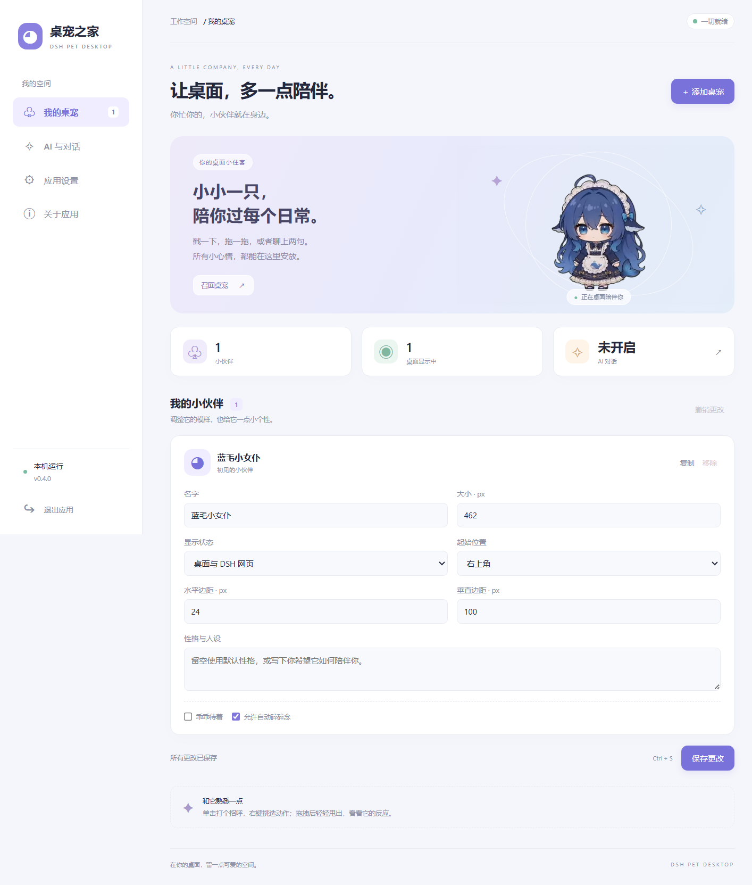
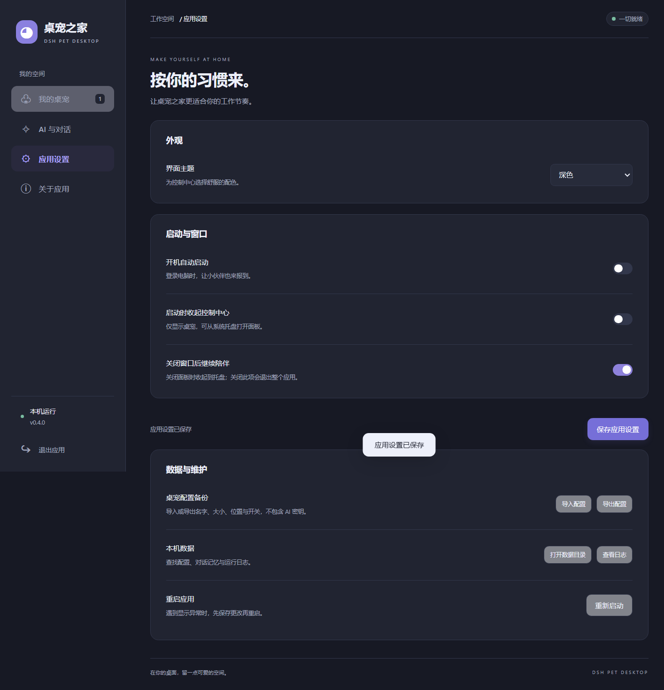

# 桌宠之家 · DSH Pet Desktop

一个独立运行的桌面宠物应用。透明动画、可拖拽的小伙伴、可选的 AI 对话，以及一个用起来顺手的控制中心。

基于 [PC2005-cloud/dsh-pet](https://github.com/PC2005-cloud/dsh-pet) 开发，保留原项目的动画运行时与 MIT 许可。**安装桌面版即可使用，不需要 DeepSeek Harness、Node.js 或浏览器。**

[跨平台构建](docs/cross-platform.md) · [导入其他桌宠](docs/pet-packs.md) · [Android 预览版](android/README.md) · [下载 Windows 安装包](https://github.com/w1nterdec/dsh-pet-desktop/releases/latest) · [使用说明](#使用) · [从源码运行](#从源码运行) · [原插件文档](docs/upstream-plugin.md)



## 功能

- **桌面陪伴**：透明置顶小窗、待机和随机动作、点击回应、拖拽甩抛、右键动作菜单、多屏活动。
- **桌宠管理**：添加、复制、移除、改名，设置大小、起始角落、边距、显示状态和独立人设；支持撤销未保存的更改与 Ctrl+S。
- **找回小伙伴**：一键召回内置桌宠到右下角，恢复桌面显示。
- **AI 与对话**：支持 OpenAI 兼容接口与 Anthropic，可测试连接、手动聊天与碎碎念。AI 默认关闭，自动碎碎念需单独开启。
- **应用偏好**：浅色 / 深色 / 跟随系统、开机启动、启动时收起控制中心、关闭窗口后继续陪伴或退出应用。
- **数据管理**：原生文件选择器导入导出桌宠配置；导入需确认，并在替换前备份现有配置；备份不包含 AI 密钥。
- **运行维护**：记住窗口尺寸与位置，单实例运行，托盘唤回，打开数据目录与日志、复制诊断信息、重启和退出。
- **素材导入**：ZIP / WebM / GIF / 图片 / 视频 / PNG 序列，以及 Shimeji 外观适配；导入校验、失败回滚、显示隐藏和配置归档。非 WebM 格式在桌面端需要 FFmpeg。
- **跨平台开发**：macOS Intel / Apple Silicon 的 DMG/ZIP、Linux AppImage/Debian 构建入口，Linux XDG 自启动与 Wayland 能力提示；Android 内置 106 个动作、多宠物悬浮窗、物理交互、可选 AI 聊天与加密记忆。
- **发行交付**：Windows x64 安装向导、快捷方式、卸载入口，以及桌面多平台和 Android 的构建工作流。



## 安装

稳定版在 [Releases](https://github.com/w1nterdec/dsh-pet-desktop/releases/latest) 下载 `DSH-Pet-Setup-0.4.1-x64.exe`，运行安装向导即可。

跨平台预览构建从 GitHub Actions 下载：打开 [桌面构建](https://github.com/w1nterdec/dsh-pet-desktop/actions/workflows/desktop-build.yml) 中成功的运行，在 **Artifacts** 选择 Windows x64、macOS x64 / arm64 或 Linux x64；Android APK 位于 [Android 构建](https://github.com/w1nterdec/dsh-pet-desktop/actions/workflows/android-build.yml) 的 `DSH-Pet-Android-preview`。下载 Actions 产物通常需要登录 GitHub。

2026-10-24 已通过 Windows、macOS Intel / Apple Silicon、Linux X11 的原生打包与交互检查，以及 Android 的编译、单元测试和 Lint。Android 仍需真机验收，多屏、不同 Linux 桌面和手机厂商后台策略仍需设备兼容性测试。详见 [跨平台说明](docs/cross-platform.md)。

安装包暂未进行代码签名。无需管理员权限；默认安装到当前用户目录。

## 使用

1. 打开「DSH Pet」，控制中心与桌面小伙伴会一起出现。
2. 在「我的桌宠」调整名字、大小、位置或性格，然后点击「保存更改」。配置会立即应用。
3. 在「AI 与对话」填写服务商的基础接口地址、模型 ID 和 API 密钥，测试连接后显式启用 AI。
4. 右键桌宠选择动作、对话或碎碎念。自动碎碎念可能产生 API 费用，默认关闭。
5. 默认关闭控制中心只会收起窗口，桌宠继续运行。点击托盘图标可唤回；托盘菜单或面板中的「退出应用」会结束整个应用。

开机启动在打包后的 Windows / macOS / Linux 应用中可配置，Linux 遵循 XDG Autostart。开机登录时会收起面板；「启动时收起控制中心」也可控制普通启动行为。关闭开机启动会移除本应用对应的启动项。

### 数据与隐私

- 桌宠配置和运行日志默认位于 `%USERPROFILE%\.dsh\dsh-pet`，可用 `DSH_HOME` 指定其他根目录。
- `main-config.jsonc`：内置桌宠配置；`desktop-settings.json`：应用偏好与窗口位置。
- `standalone-ai.json`：本机 AI 连接设置与密钥；`memory.json`：对话记忆；`logs.txt`：运行日志。
- 密钥不回显，保存在当前用户可访问的本机配置中。启用 AI 后，对话内容和必要上下文会发送给你填写的服务商；本应用没有自建中转服务。
- 导出的 JSON 仅包括内置桌宠配置及屏幕约束开关；不包括 API 密钥、聊天记忆、应用偏好或额外 pet pack 素材。
- 导入前会先检查格式，并要求确认。原有主配置备份为 `main-config.before-import.jsonc`；导入不会覆盖额外 pet pack 配置或 AI 设置。
- 诊断复制仅包含版本、系统、架构与运行模式，不包含密钥和本机路径。

### 边界

独立桌面应用不提供 DSH 的余额查询、会话工作状态或 DSH 系统通知。额外 pet pack 和自定义动画沿用原项目文件结构。控制中心可导入素材包并管理显示/隐藏/移除；召回和主配置编辑仍作用于内置桌宠。Android 0.2 提供原生 AI 聊天、独立人设和本机加密记忆，可导入/导出图片动作包及精灵图；Android 与桌面数据分别保存。Live2D/VRM 模型与原 Shimeji Java 行为需要专用运行时适配。

## 从源码运行

需要 Node.js **22.12 或更新版本**；推荐 Node.js 24。以下命令在仓库根目录开始执行：

```powershell
git clone https://github.com/w1nterdec/dsh-pet-desktop.git
cd dsh-pet-desktop/dsh-pet
npm install
npm run ensure:electron
npm run desktop
```

`ensure:electron` 首次下载运行时。网络受限时，可用 `DSH_PET_ELECTRON_MIRROR` 指定镜像，或设置 `DSH_PET_ELECTRON_PATH` 指向已有的 Electron 可执行文件。构建会同时生成桌面共享核心，不能只运行裸 `tsdown` 后直接分发。

仓库保留 `pnpm-lock.yaml`。使用 pnpm 12 时可执行 `pnpm install --frozen-lockfile`；CI 使用这条固定依赖链。

## 构建与验证

```powershell
cd dsh-pet
npm run build
npm run typecheck
npm run lint
npm test
npm run test:app

# 绿色目录：dist-app/win-unpacked/
npm run dist

# 安装包：dist-app/DSH-Pet-Setup-0.4.1-x64.exe
npm run dist:installer

# 对打包后的应用执行相同的原生交互验证
$env:DSH_PET_APP_EXECUTABLE = (Resolve-Path 'dist-app/win-unpacked/DSH Pet.exe').Path
npm run test:app
```

原生测试使用隔离的临时配置和 Chromium 数据目录，覆盖 AI 设置访问、宠物增删和保存、动画解码、主题持久化、桌宠召回及托盘恢复。测试不会启用付费 AI 或写入真实开机启动项。

`Desktop app checks and Windows installer` 工作流会在源码提交时检查并生成可下载的 Windows 构建产物。发布 Release 后，发行工作流会为对应 tag 构建安装包并上传到该 Release。

## 目录

- `dsh-pet/src/app/`：原生应用入口、控制中心、偏好、备份与维护接口。
- `dsh-pet/src/standalone/`：本机 AI 服务及设置。
- `dsh-pet/runtime/electron-helper/`：透明桌宠窗口、动画与桌面交互。
- `dsh-pet/src/shared/`：共享物理和动画逻辑。
- `dsh-pet/assets/`：运行素材；`dsh-pet/scripts/tests/`：原生交互验证。
- `docs/`：界面截图、变更记录及原插件文档。

## 致谢与许可

本项目是 [PC2005-cloud/dsh-pet](https://github.com/PC2005-cloud/dsh-pet) 的衍生桌面应用，沿用其开源代码与素材。原作者版权声明保留于 [LICENSE](LICENSE)，项目以 MIT 许可提供。

欢迎通过 [Issues](https://github.com/w1nterdec/dsh-pet-desktop/issues) 反馈问题；请附上系统、应用版本、复现步骤和脱敏后的日志，勿提交 API 密钥或私人对话。
